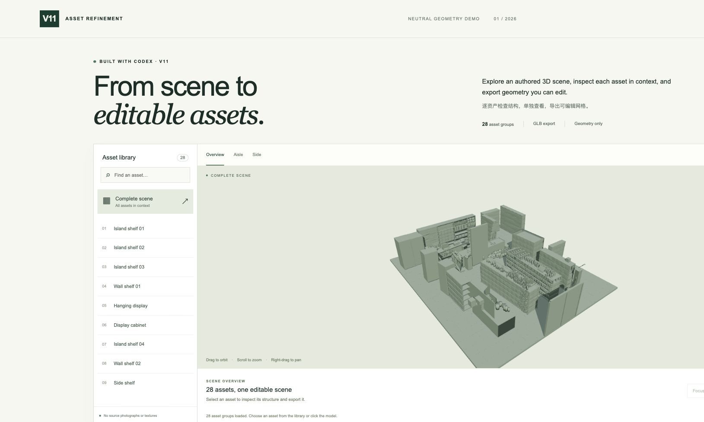
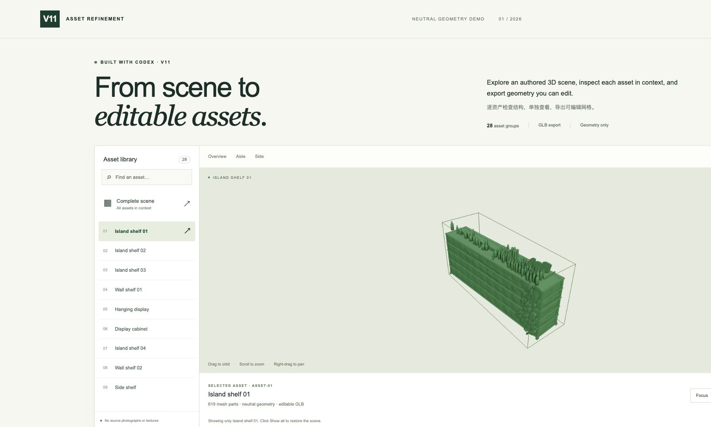

# 用 Codex 做一个可检查、可导出的三维资产查看器

这个 V11 演示把一个三维场景分成 28 个资产组。你可以从整体场景找到某个货架或柜体，单独检查它，再导出为可继续编辑的 GLB。



## 启动

在仓库根目录执行：

```sh
python3 -m http.server 8000
```

用支持 WebGL 的现代浏览器打开 [localhost:8000](http://localhost:8000)。不要直接双击 HTML 文件。首次需要加载约 43 MB 的模型；依赖已放在仓库中，不需要 API Key 或额外构建。

## 完成一次资产检查

1. 在 **Overview** 查看整体。拖动旋转、滚轮缩放、按住右键拖动平移。
2. 从左侧选择 **Island shelf 01**。对应几何会高亮，底部显示当前资产和网格部件数量。
3. 点击 **Focus** 拉近，再点 **Isolate** 单独查看。**Wireframe** 可以检查线框结构。
4. 点击 **Export asset**，得到 `asset-01.glb`。在 Blender 中通过“文件 → 导入 → glTF 2.0”打开，继续编辑其中的网格部件。
5. 点击 **Show all** 恢复上下文，或按 **Escape** 回到整体视角。输入搜索词可以筛选资产列表。



## 与 Codex 协作时，任务如何拆

先确定一条可完成的操作链：找到对象、看清结构、导出、在后续工具中继续编辑。围绕这条链实现最小功能，再用真实资产检查每一步的反馈。

例如，不只要求“做一个三维页面”，而是要求“选择货架后高亮，拉近时保持对象完整，单独查看后能恢复，导出的 GLB 保留部件层级”。验收时实际操作同一个货架，核对画面、选择状态和导出文件。Codex 参与实现了查看器、选择与导出工具，以及公开发布检查。

## 公开内容的边界

这里仅包含中性几何、变换和层级，不包含原始照片、商品贴图、原始相机、来源备注或识别性元数据。没有人物照片。

模型包含人工构建和推测的隐藏表面，尺寸与布局也存在估计。它适合演示资产检查与编辑流程，不能作为实测模型、真实库存或重建精度的证明。仓库不提供从原始照片完整重建该场景的算法。

原创建模查看器代码采用 MIT 许可；演示几何不在代码 MIT 许可范围内。详见主 [README](../README.md)。
